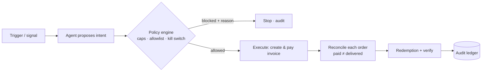

# Life OS

**The autonomous operating system for everyday life.**

Connect a person's digital life once → build a permissioned **Life Graph** → detect useful moments → let bounded, auditable agents take action (replenish, book, renew, buy digital goods) **within rules you control** — without re-prompting.

Built for the **Free Society Hack** (Zcash × Bitrefill, Mumbai, 4–5 Nov 2026). Life OS targets **both tracks**: *Agentic Commerce* (an agent that finds, buys and pays through Bitrefill on its own) and *Privacy* (payments that can be authorized but never seized, settled with shielded ZEC).

---

## The one idea that makes it safe

> The model **proposes**. Deterministic code **decides**. A wallet **executes**. A verifier **reconciles**.

The LLM never holds funds, keys, or spend limits. Every agent action runs through a deterministic policy engine (per-transaction cap, monthly budget, merchant/category allowlist, kill switch) enforced in **backend code, never in a prompt**. An allowed intent executes under an idempotency key (no duplicate orders); a separate verifier confirms fulfilment; and every step lands in an append-only audit log.



---

## What's built

| Area | Status | Notes |
| --- | --- | --- |
| **Landing page** | ✅ Live | Distinctive "Obsidian Signal" theme, animated Life Graph constellation, scroll reveals |
| **Dashboard UI** | ✅ Live | Sources, Life Graph, Triggers, Policy, Commerce, Shielded Pay, Audit |
| **Bitrefill backend** | ✅ Live | Real REST API v2: search → policy → invoice → reconcile → redemption → audit |
| **Connectors (Gmail/Calendar/OAuth)** | 🟡 Mocked | Seeded Life Graph, fake OAuth flows — by design for the demo |
| **Zcash shielded payment** | ⬜ Planned | Phase B: real testnet shielded leg (see `plans/03-...`) |

**Live vs mocked boundary:** the dashboard's **Commerce, Policy, and Audit** panels call the real backend (live Bitrefill). Everything else — connectors, Life Graph records, the trigger clock — is mocked client-side so the demo runs without real user data.

---

## Repository layout

```
lifeos/
├── frontend/              Next.js 16 · React 19 · Tailwind v4 · Bun · motion · Phosphor
│   └── app/
│       ├── page.tsx                  landing page
│       ├── dashboard/                dashboard route
│       ├── components/               ui · atmosphere · landing · dashboard
│       ├── lib/
│       │   ├── api.ts                typed client for the backend
│       │   ├── icons.tsx             Phosphor icon registry
│       │   └── mock/                 seeded Life Graph, connectors, triggers (mocked)
│       └── providers/LifeOSProvider.tsx   mocked app state
├── backend/               FastAPI · httpx · SQLite (uv, Python 3.13)
│   ├── main.py            entrypoint — `uv run main.py`
│   ├── app.py            policy.py  audit.py  db.py  config.py  models.py
│   ├── bitrefill/        client.py (REST v2) + service.py (orchestration)
│   └── routers/          commerce.py · policy.py · webhooks.py
├── plans/                 execution plans (gitignored)
├── PROJECT_CONTEXT.md     deep context: spec, design system, data model
└── README.md             you are here
```

---

## Quickstart

Two processes: the backend (port 8000) and the frontend (port 3000). You need a free **Bitrefill API key** (`bitrefill.com/account/developers`).

### 1 · Backend

```bash
cd backend
cp .env.example .env          # set BITREFILL_API_KEY=...
uv run main.py                # uvicorn on http://127.0.0.1:8000  (RELOAD=1 for autoreload)
```

Check it: `curl localhost:8000/health` → `{"status":"ok","bitrefill":{"ping":"pong",...}}`.

### 2 · Frontend

```bash
cd frontend
cp .env.example .env.local     # NEXT_PUBLIC_API_BASE=http://127.0.0.1:8000
bun install
bun run dev                    # http://localhost:3000
```

Open `http://localhost:3000` for the landing page, `http://localhost:3000/dashboard` for the app.

> Dev purchases use Bitrefill **test products** (free, real API, real redemption codes) because the demo account balance is $0. Swapping one `product_id` to a real catalogue item makes it a live buy — no code change.

---

## The live commerce flow (dashboard → Commerce tab)

1. **Search** the real Bitrefill catalogue (`GET /products/search`) — genuine eSIMs, gift cards, prices.
2. **Propose** an intent (`POST /intents`) → the backend runs `policy.evaluate()` and returns `allowed` / `blocked` with a reason.
3. **Execute** an allowed intent (`POST /intents/{id}/execute`) → re-checks policy, creates & pays a real invoice (idempotent), **polls each order to delivery** (paid ≠ delivered), returns the **real redemption code**, decrements the budget, writes the audit trail.
4. **Policy** tab edits the live policy (`PUT /policy`) — lower the per-transaction cap below the demo price and the *same* purchase gets **blocked in code**.
5. **Audit** tab polls the live ledger (`GET /audit`) — every proposal, order, and fulfilment with a human-readable reason.

### Backend API

| Method | Path | Purpose |
| --- | --- | --- |
| GET | `/health` | self + Bitrefill ping + balance |
| GET | `/products/search?q=&country=&limit=&include_test=` | live catalogue search |
| GET | `/products/{id}` | denominations (packages / range) |
| POST | `/intents` | propose → runs policy, returns allowed/blocked |
| POST | `/intents/{id}/execute` | re-quote → create+pay invoice → reconcile → redemption |
| GET | `/intents/{id}` | intent + invoice + order + redemption status |
| GET | `/orders/{id}` | redemption info |
| GET / PUT | `/policy` | read / update autonomy policy |
| POST | `/kill-switch` | toggle global pause |
| GET | `/audit?limit=` | append-only audit ledger |

---

## Design system — "Obsidian Signal"

A nocturnal, instrument-grade "mission control for a life". Dark obsidian canvas, **signal gold** for live agent activity (a Zcash nod), **shielded jade** for confirmed/private states, **alert red** for blocked.

- **Fonts:** Fraunces (display) · Hanken Grotesk (body) · Geist Mono (data/labels/audit).
- **Icons:** Phosphor (`@phosphor-icons/react`) via a central registry; brand marks are real downloaded favicons in `public/brands/`.
- **Motion:** `motion/react` — staggered hero reveal, scroll-triggered sections, animated constellation, live audit polling.

---

## Tech stack

| Layer | Tech |
| --- | --- |
| Web dashboard | Next.js 16 (App Router) · React 19 · Tailwind v4 · Bun · motion · Phosphor |
| Backend | FastAPI · httpx · SQLite · uv · Python 3.13 |
| Commerce | Bitrefill eCommerce REST API v2 — `https://api.bitrefill.com/v2` |
| Payments (planned) | Zcash shielded testnet (ZPay / x402 path), two verified legs |

---

## Roadmap

- **Phase A — Bitrefill (done):** live agentic-commerce loop, deterministic policy, audit ledger, dashboard wiring.
- **Phase B — Zcash (next):** a real shielded ZEC **testnet** payment demonstrated as a *separate verified leg* (Bitrefill doesn't accept ZEC directly — the ZEC→USDC swap is mainnet-only). Recommended path: ZPay (x402 + spend-limited agent wallet). Wires the dashboard's Shielded Pay panel to real transactions.
- Wire the dashboard kill switch to the backend `/kill-switch` so it gates live execution.

See `plans/` and `PROJECT_CONTEXT.md` for the full specification and data model.

---

## Security & honesty notes

- The Bitrefill API key can spend on the account — it lives only in `backend/.env` (gitignored), never in the repo or the frontend bundle.
- Spend caps, allowlists, and idempotency are enforced in backend code, not in an LLM prompt.
- Shielded ZEC hides the sender and amount **on-chain** — it does **not** hide your order from the merchant or fulfilment partner. Any simulated leg is always labelled as such.
